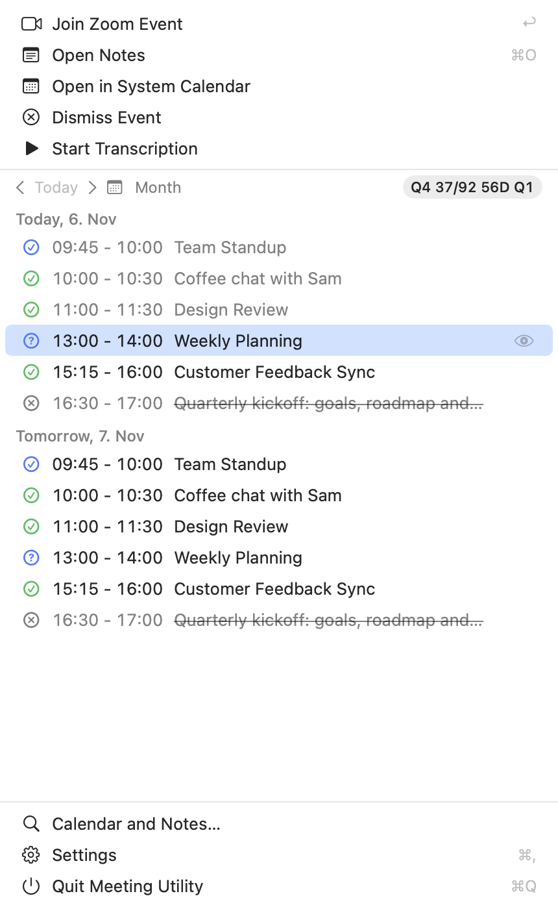
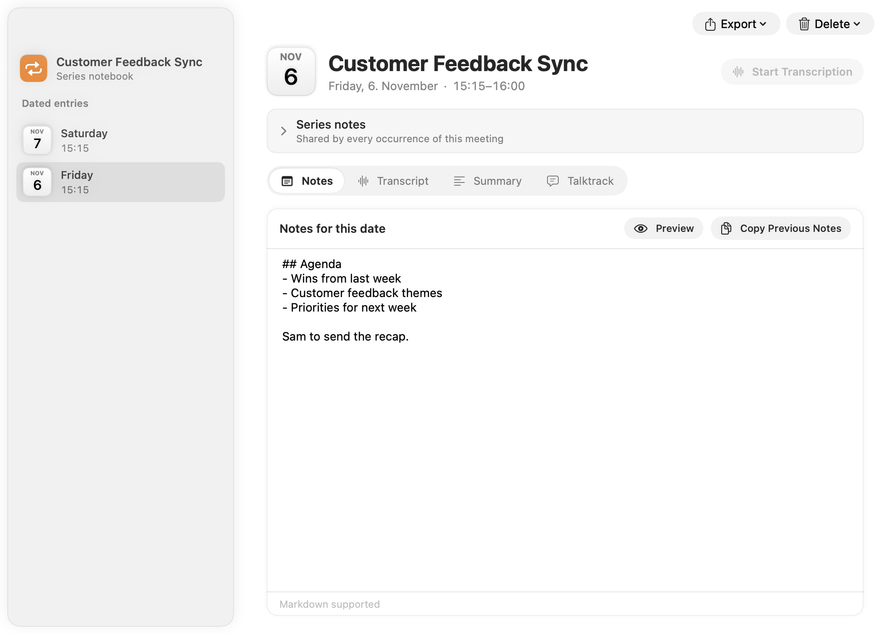

<p align="center">
  
</p>

<h1 align="center">meetingutils</h1>

<p align="center">
  <strong>Every meeting, handled. On your Mac.</strong><br>
  A free, open-source meeting companion for macOS: one-click joining, a notebook for every recurring meeting,
  a floating teleprompter, and transcripts and summaries from AI that runs entirely on your Mac.
</p>

<p align="center">
  <a href="https://github.com/devtanna/meeting-utilities/releases/latest"></a>
  
  
  <a href="LICENSE"></a>
  <a href="CONTRIBUTING.md"></a>
</p>

<p align="center">
  <a href="https://github.com/devtanna/meeting-utilities/releases/latest"><strong>Download</strong></a> ·
  <a href="https://meetingutils.app">Website</a> ·
  <a href="#features">Features</a> ·
  <a href="#build-from-source">Build</a> ·
  <a href="docs/privacy.md">Privacy</a>
</p>

## Features

- **Agenda in the menu bar or the notch.** Today and tomorrow at a glance, keyboard-driven (↑/↓, Return to join,
  ⌘O for notes). On Macs without a notch, notch mode becomes a small capsule at the top of the screen.
- **One-click join** for Google Meet, Zoom and Microsoft Teams, in the native app or your browser. Optional
  **auto join** at the start time.
- **Notebooks per recurring meeting.** Series notes shared by every occurrence, plus dated notes for each one,
  in Markdown. Copy last week's notes forward in one click.
- **Talktrack**, a floating teleprompter that stays above the call window and scrolls at your pace, with a script
  per meeting.
- **Local transcription and summaries.** [Parakeet](https://huggingface.co/nvidia/parakeet-tdt-0.6b-v2) speech-to-text
  and Qwen3 4B summaries, run with Apple's [MLX](https://github.com/ml-explore/mlx-swift) in a separate on-demand
  process. Models are optional downloads.
- **Reminders and Do Not Disturb.** Native notifications before meetings, plus a Focus mode that turns on while you're
  in a call.
- **Sounds.** A cue before each meeting and an optional clock-aligned chime (e.g. every 30 minutes) limited to the
  days and hours you choose. They stay silent while you're away from the Mac.
- **Quarter tracker.** Always know where the quarter stands: `Q4 37/92 · 56D to Q1`.

<p align="center">
  
  &nbsp;
  
</p>

## Privacy

Everything runs on your Mac. There is no account, telemetry, analytics, cloud AI or sync.

- Audio is processed in small in-memory buffers and **never written to disk**. Only transcripts, summaries and your
  notes are saved, in a local SQLite database.
- Calendar access is read-only.
- The app connects to the network only to download models you choose (from Hugging Face) and, in signed release
  builds, to check for updates.

Details, including a table of every piece of data and where it goes: [docs/privacy.md](docs/privacy.md).

## Install

1. Download the latest `.dmg` from [Releases](https://github.com/devtanna/meeting-utilities/releases/latest).
2. Drag **MeetingUtility** to Applications and open it. It lives in the menu bar and has no Dock icon.
3. The setup assistant walks you through calendars, reminders and the optional AI models.

**Requirements:** an Apple Silicon Mac (M1 or later) on macOS 15 or newer. 16 GB of memory is recommended if you use
transcription and summaries together.

> [!NOTE]
> Current builds are not notarized yet. On first launch macOS will refuse to open the app: go to
> **System Settings › Privacy & Security** and click **Open Anyway**. See
> [docs/INSTALL-TESTERS.md](docs/INSTALL-TESTERS.md) for a step-by-step guide.

## Build from source

Requirements: Xcode 26 or newer, [XcodeGen](https://github.com/yonaskolb/XcodeGen) (`brew install xcodegen`) and an
Apple Silicon Mac.

```sh
git clone https://github.com/devtanna/meeting-utilities.git
cd meeting-utilities
cp Config/Identity.example.xcconfig Config/Identity.xcconfig
scripts/bootstrap.sh      # checks the toolchain, generates the Xcode project, resolves packages
make dev                  # Debug build, launch, stream logs (Ctrl-C quits)
```

| Command | What it does |
|---|---|
| `make dev` | Build Debug and run as a real app, so permission prompts work |
| `make dev-fake` | Same, with a synthetic calendar and a separate sandbox database |
| `make test` | Package unit tests plus the model-manifest check |
| `make release` | Release build, then `.dmg`, `.zip` and `SHA256SUMS.txt` in `dist/` |
| `make publish` | Bump the version, test, build, tag and publish a GitHub release ([docs/release.md](docs/release.md)) |
| `make help` | All targets |

`MeetingUtility.xcodeproj` is generated from `project.yml` and is not committed. Open it in Xcode after
`scripts/bootstrap.sh`. Bundle ID, version, signing team and the update feed live only in `Config/Identity.xcconfig`,
which is git-ignored.

<details>
<summary><strong>Developer launch flags</strong></summary>

| Flag | Effect |
|---|---|
| `-UseFakeCalendar YES` | Synthetic calendar with a separate database and preferences (never touches your real notes) |
| `-RenderSnapshots <dir> -QuitAfterSnapshots YES` | Renders agenda, settings, notebook and onboarding PNGs offscreen |
| `-SelfTest <report.json> -SelfTestPCM <file> [-SelfTestDownload YES]` | End-to-end XPC, MLX and model self-test |

</details>

## Project layout

```
App/                       App target: shell, agenda, notebook, history, Talktrack, sounds, settings, onboarding
InferenceService/          Embedded XPC service. The only process that links MLX
Packages/MeetingKit/       MeetingCore (pure domain), MeetingData (GRDB), MeetingAudio, InferenceProtocol
Packages/InferenceEngines/ Parakeet and Qwen adapters, plus the inference-bench tool
Config/                    xcconfig files (Identity.example.xcconfig is the template)
scripts/                   bootstrap, build, test, release and audit scripts
docs/                      Architecture, decisions, privacy, models, schema, release process
```

Start with [docs/architecture.md](docs/architecture.md) and [docs/decisions.md](docs/decisions.md).

## Contributing

Bug reports, ideas and pull requests are welcome. Please read [CONTRIBUTING.md](CONTRIBUTING.md) first. For security
issues, follow [SECURITY.md](SECURITY.md) instead of opening a public issue.

## Acknowledgements

Built on [MLX Swift](https://github.com/ml-explore/mlx-swift), [mlx-swift-lm](https://github.com/ml-explore/mlx-swift-lm),
[mlx-audio-swift](https://github.com/Neywa-Labs/mlx-audio-swift), [GRDB](https://github.com/groue/GRDB.swift),
[Sparkle](https://github.com/sparkle-project/Sparkle) and
[KeyboardShortcuts](https://github.com/sindresorhus/KeyboardShortcuts). Full third-party licenses and model
attribution are in [THIRD_PARTY_NOTICES.md](THIRD_PARTY_NOTICES.md).

## License

[MIT](LICENSE) © 2026 Dev Tanna
